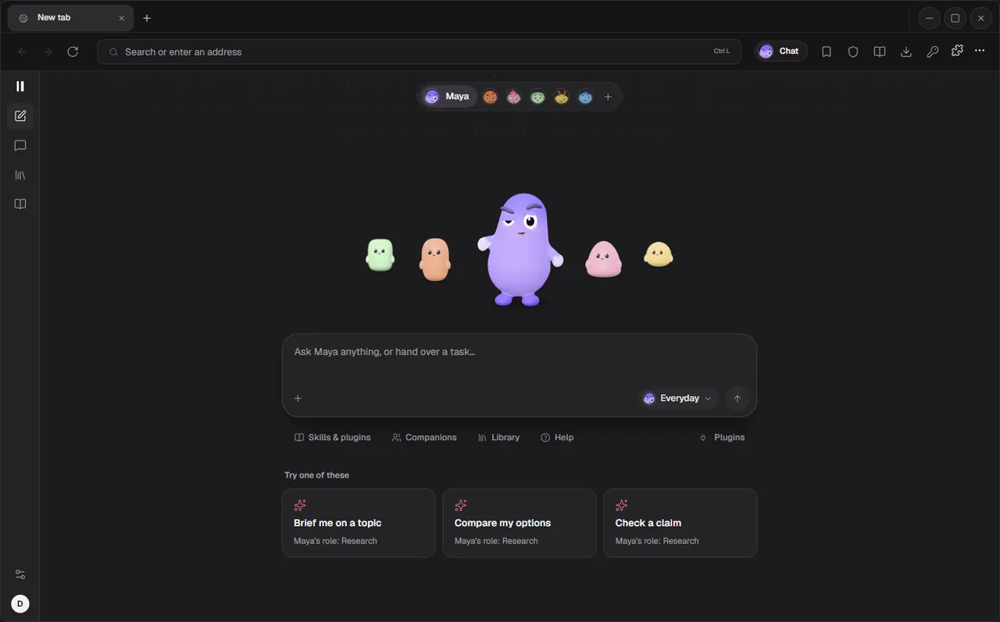
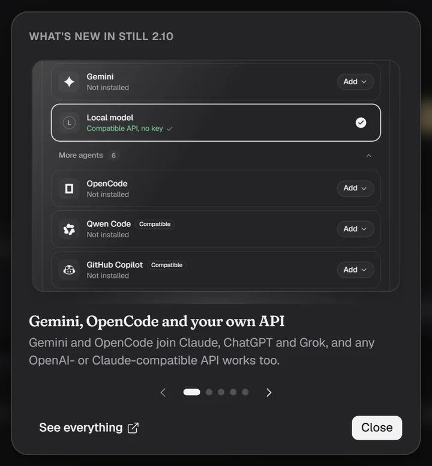
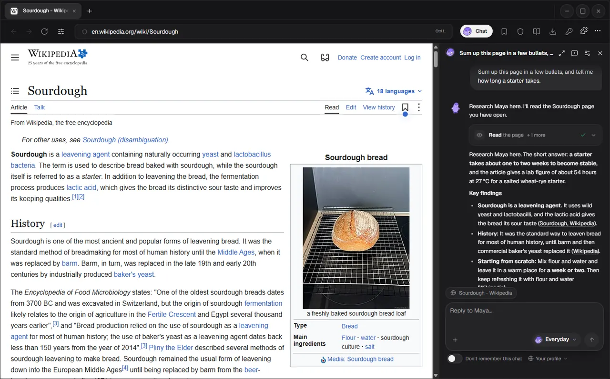
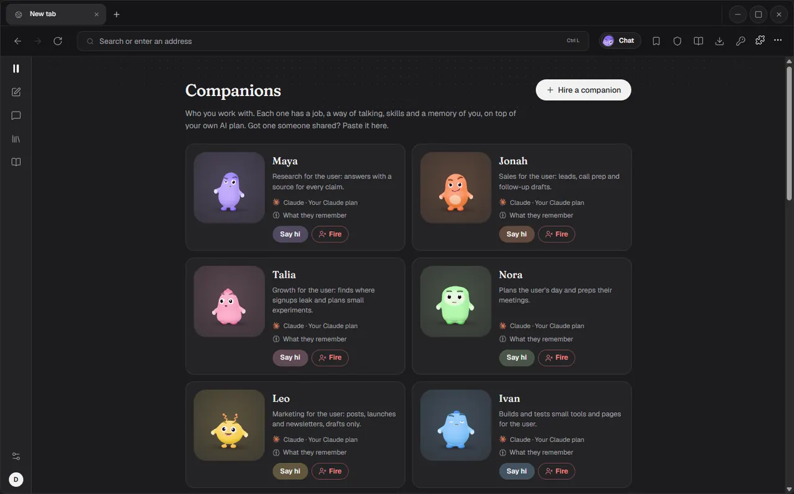
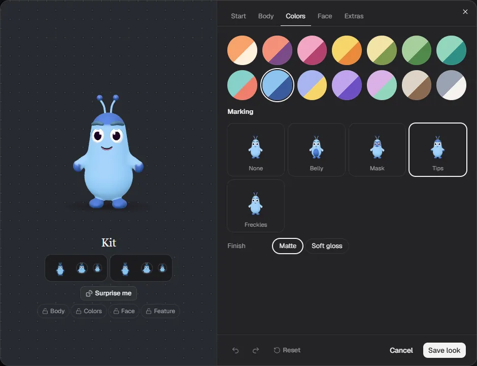
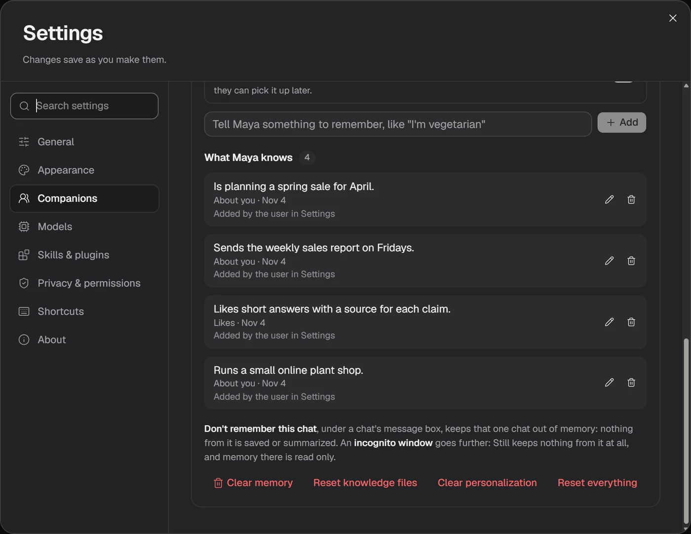
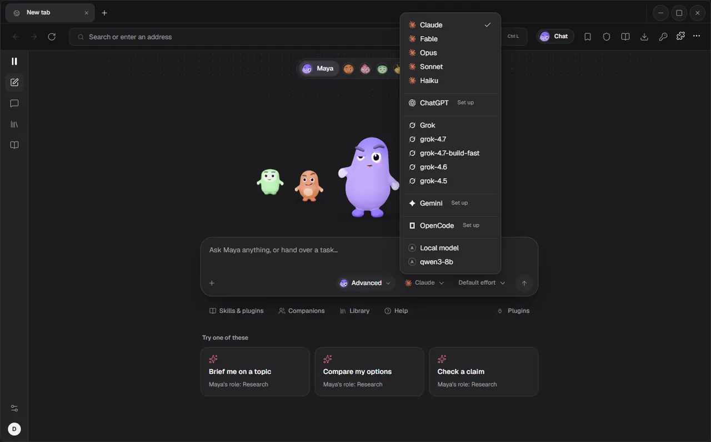
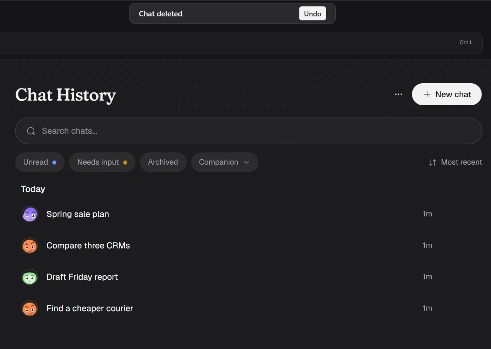
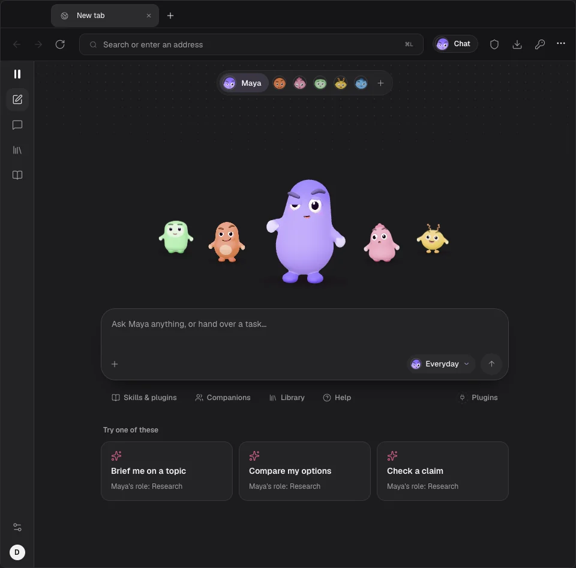

<div align="center">

# still.

**An open-source browser with AI companions that run on the Claude, ChatGPT, Grok, Gemini or OpenCode app you're already signed into. Or bring an OpenAI- or Claude-compatible API.**

[**Download for Windows**](https://github.com/carbongotfound/still/releases/latest/download/Still-Setup-x64.exe) · [**Download for Mac**](https://github.com/carbongotfound/still/releases/latest/download/Still-mac.dmg) · [**What's new**](#whats-new-in-210) · [**What you can do**](#what-you-can-do-with-still) · [**Install**](#install) · [**Contributing**](#contributing)

[](https://github.com/carbongotfound/still/releases/latest)
[](./LICENSE)


[](https://github.com/carbongotfound/still/labels/good%20first%20issue)

</div>

<!-- LAUNCH FILM -->
<!-- The launch film goes here, between the pitch and the first screenshot: an embed or a linked thumbnail. -->

<p align="center"></p>

Still is a real browser with a team of AI companions built in. Hire the ones you need, hand them a task, and they get on with it in their own background tabs: reading pages, clicking, typing, filling forms and reporting back. They think with the AI app you already pay for, so there's no new plan and no key to paste. Everything stays on your computer.

## What's new in 2.10

The first time 2.10 opens, a short tour shows these. You can open it again from **Settings > About**.



- **Gemini, OpenCode and your own API.** Gemini and OpenCode join Claude, ChatGPT and Grok, and any OpenAI- or Claude-compatible API works too.
- **Setup in four steps.** Connect your model, make a companion and give it a first task, all in one go.
- **Make them look your way.** Pick a body, colors, a face and extras in the new look editor.
- **See what they remember.** Every fact a companion keeps, with where it came from. Change or forget any of it.
- **Undo when you delete.** Deleting a chat, a companion or your data asks first, then gives you a few seconds to undo.

The full list is in [FEATURES.md](FEATURES.md).

<br clear="right">

## What you can do with Still

### Ask about the page you're on

Open the side chat on any page and ask away. The companion reads the page, answers, and offers the next step as a choice card you answer in one click. In this shot it runs on a local test model added as a Compatible API.

<p align="center"></p>

### Hire a team for the busywork

Six companions come ready to hire, each with a job, skills, routines and a memory of you. Say hi to start a chat, or Fire one you don't need (it asks first, and you can undo).

| Role | Who | What to expect |
|---|---|---|
| **Sales** | Jonah | A one-page brief before every sales call, lead lists that fit who you sell to, follow-ups in your voice sent only on your OK |
| **Growth** | Talia | The biggest leak in your funnel with the number, small experiments ranked with one metric each, copy launched only on your OK |
| **Planner** | Nora | Tomorrow planned tonight with the most important thing first, a two-minute brief before each meeting, replies drafted |
| **Marketing** | Leo | One idea turned into posts for every platform, launch posts and newsletters in your voice, drafts only |
| **Engineer** | Ivan | Small tools and pages built and tested in Still, bug reports with steps to reproduce, specs from messy feedback |
| **Research** | Maya | Deep research with cited sources, options compared side by side, claims fact-checked before you share them |

<p align="center"></p>

### Make your own, and make it look right

Need a job the six don't cover? Make your own: a name, a role, a personality and what it's for, and Still drafts its instructions and first skills for you to check. Then dress it up in the look editor.

<p align="center"></p>

### See what they know about you

Every fact a companion keeps shows up in Settings with where it came from. Add things yourself, fix them or make them forget. Passwords, codes, form fields and private tabs are never kept.

<p align="center"> Companions: what Maya knows, four facts each with where it came from, and buttons to edit or forget" width="700"></p>

### Use the AI you already have

Pick Claude, ChatGPT, Grok, Gemini or OpenCode, signed in with your own plan, and switch any time, even mid-chat. Or plug in an OpenAI- or Claude-compatible API, like a model running on your own machine.

<p align="center"></p>

### Delete without the panic

Deleting a chat, a companion, a memory, a key or your history asks first and says what goes. Then you get about six seconds to undo before anything is really deleted.

<p align="center"></p>

## Supported AI apps

Still runs the AI's own app in the background. It never asks for a key for these and never reads the app's login. Claude Code keeps its own sign-in and any API key, auth token or cloud provider set in your environment; when one of those is in use, Claude's card in **Settings > Models** says so, because that account gets billed. For the other apps, Still strips API-key settings from each run, so nothing gets billed to an API account.

| AI | What Still runs | How it connects |
|---|---|---|
| **Claude** | [Claude Code](https://claude.com/product/claude-code) | **Install it for me** runs Anthropic's official installer. **Sign in with Anthropic** opens Claude's own sign-in. |
| **ChatGPT** | OpenAI's agent CLI | **Install it for me** installs it from npm. **Sign in with OpenAI** uses your ChatGPT account. API-key logins are ignored. |
| **Grok** | [Grok Build](https://x.ai/cli) | **Install it for me** runs xAI's official installer. **Sign in with xAI** opens xAI's device sign-in. |
| **Gemini** | [Gemini CLI](https://github.com/google-gemini/gemini-cli) | **Install it for me** installs it from npm. To sign in, run `gemini` in a terminal and pick **Sign in with Google**. |
| **OpenCode** | [OpenCode](https://opencode.ai) | It runs on the provider you set up inside OpenCode (`opencode providers login`). |
| **OpenAI-compatible API** | Still's own agent | Base URL, model and an optional key, in setup (**Use an API instead**) or **Settings > Models**, under **More agents** (**DeepSeek** comes filled in). Labelled **Compatible**. |
| **Claude-compatible API** | Still's own agent | Same as above, for services that speak the Anthropic Messages format. Labelled **Compatible**. |

Qwen Code, GitHub Copilot CLI, [DeepSeek Harness](https://github.com/deepseek-ai/deepseek-harness) (DeepSeek's own agent, a developer preview) and Amp (Mac only) are there too, labelled **Compatible**.

To add one, pick **Add a model** in Still's menu. It opens **Settings > Models**, where **Your models** lists every app with its state on your computer (**Logged in**, **Installed** or **Not installed**) and an **Add** or **Set up** button. Claude, ChatGPT, Grok and Gemini come first; the others and the API presets wait under **More agents**. If an app is already installed and signed in, Still finds it.

**About Compatible APIs:** you pay your provider per use. The key goes in Windows DPAPI or the macOS Keychain, only its last four characters ever show, and it's sent only over https (plain http only to `localhost` and `127.0.0.1`). **Test connection** checks the address, key, model, streaming and tool calls with one tiny request, which your provider may bill. They're labelled **Compatible** because Still tests them against its own test server, not against every real provider.

## Also in the box

- **A full browser.** Tabs, groups, split view, private windows and profiles, tabs on top or on the side. Ads and trackers blocked, YouTube ads included, and one-click import from Chrome, Edge, Brave, Opera GX, Vivaldi and Firefox.
- **The message box.** `#` attaches a tab, `@` pulls in a teammate, `/` runs a skill, and you can drop in up to 10 files.
- **Drafts and undo.** What you type in a message box comes back after a refresh or a restart, and Ctrl+Z (Cmd+Z on the Mac) brings back text you deleted.
- **Plugins.** Gmail, Slack, Notion, GitHub and the rest of [Composio](https://composio.dev)'s catalog, with **your own** Composio key. Reads go ahead, anything that sends, posts, deletes or pays asks first.
- **You stay in charge.** Per-site permissions, AI rules per site and per companion, and an 8 second countdown you can cancel before buying, sending, deleting or touching a payment field. A colored cursor shows where the companion clicks, **Take over** lets you drive, **Stop** ends the run.
- **A password manager** encrypted with Windows DPAPI or the macOS Keychain. Companions never see saved passwords.
- **Use Still from other AI apps.** Turn on **Settings > Models > Let other AI apps use Still** and Claude Code, Claude Desktop, Cursor or any MCP app can drive it, after asking you once.

```powershell
claude mcp add still -- "C:\Users\<you>\AppData\Local\Programs\Still\Still.exe" --mcp
```

## Install

Windows releases aren't signed yet. Where that stands, who approves releases and what Still sends over the network: [Code signing policy](#code-signing-policy).

### Windows

1. Download [**Still-Setup-x64.exe**](https://github.com/carbongotfound/still/releases/latest/download/Still-Setup-x64.exe) and run it. No admin rights needed.
2. Still isn't code-signed yet, so SmartScreen may warn the first time. Choose **More info > Run anyway**.
3. Setup walks you through connecting your model, making your first companion and giving it a task.

### macOS

1. Download [**Still-mac.dmg**](https://github.com/carbongotfound/still/releases/latest/download/Still-mac.dmg), open it and drag **Still** to **Applications**. It runs natively on Apple silicon and Intel.
2. Still isn't notarized yet, so the first time, right-click Still and choose **Open**. On macOS 15, open it once, then choose **Open Anyway** in **System Settings > Privacy & Security**.

<p align="center"></p>

### Updates

Still updates itself on Windows and the Mac. It checks for a new version when it opens and every two hours. With **Update automatically** on (the default, in **Settings > About > Updates**), the new version downloads in the background and installs the next time you close Still, or right away from **Update** in the toolbar. Turn it off and Still tells you a new version is out, then waits for you to click **Update**. **Check for updates** in the same place looks right away.

- **Windows** checks the installer's SHA-256 before it runs it.
- **Mac** updates come through [Sparkle](https://sparkle-project.org) and install only if they're signed with Still's own key. Still 2.10.0 and earlier on the Mac show **Update** and open the download page; download 2.10.1 once and it updates itself from then on.

### Requirements

- **Windows** 10 (1809 or later) or 11, x64. Setup installs the Microsoft Edge WebView2 Runtime if it's missing.
- **macOS** 12 or later.
- Linux isn't supported yet.
- **An AI** for the companions: one of the apps above signed in to your own account, or a Compatible API. Still works as a plain browser without one.

## Privacy

- **No telemetry.** No Still account, no analytics. What Still sends over the network is listed under [Code signing policy](#code-signing-policy).
- **Agents never see private tabs, saved passwords or cookies.** When a companion reaches a sign-in page it pauses and asks you to sign in, then carries on.
- **Private tabs never save passwords, history or form data.**
- **Your data stays local** in `%LOCALAPPDATA%\Still` on Windows and `~/Library/Application Support/Still` on the Mac.
- **Plugins are opt-in.** Still talks to Composio only after you paste your own key.

## Code signing policy

**Status:** Applied to SignPath Foundation for free code signing of Windows builds; approval pending. Windows releases are not signed yet.

<!-- Use this line once SignPath Foundation approves the application: Free code signing provided by SignPath.io, certificate by SignPath Foundation -->

**Team roles**

- Committers and reviewers: [carbongotfound](https://github.com/carbongotfound)
- Approvers: [carbongotfound](https://github.com/carbongotfound)

**Privacy**

Still has no account, no analytics and no server of its own. It does use the network, and some of that happens without you asking.

On its own:

- **Update check.** When Still opens and every two hours, it asks GitHub (`api.github.com`) for the latest release, with Still's version in the request. There's no setting to turn this check off.
- **Update downloads.** With **Update automatically** on (the default), a new version downloads from GitHub's release files without asking. Turn it off in **Settings > About > Updates** and nothing downloads until you click **Update**.
- **Safe-browsing checks.** Still turns on the browser engine's protection for the pages it opens: SmartScreen in WebView2 on Windows and WebKit's fraudulent website warning on the Mac. There's no setting to turn them off. Microsoft's and Apple's policies cover what those checks send.
- **Video thumbnails.** When a reply has a YouTube link on a line of its own, Still fetches the thumbnail from `i.ytimg.com`, without cookies. Other images in a reply load only after you click **Show image**.

When you or a companion ask for it:

- **Websites.** Pages you and your companions open talk to those sites, as in any browser. Companions can also search and read pages in a hidden page. Searches use your search engine, then DuckDuckGo if that finds nothing.
- **The AI apps and APIs you connect.** What you give a companion goes to the AI you picked: your messages and files, the pages it reads and what it remembers about you. Each AI app is its own program, with its own network use and its own maker's policy. **Install it for me** downloads the app from its maker or from npm. A Compatible API gets these requests, with your key, at the address you enter.
- **Composio plugins.** Off until you paste your own Composio key. After that, Still fetches Composio's app catalog and logos, and the plugin actions you and your companions run go to Composio and on to the app you connected.
- **WebView2 Runtime, on Windows.** If it's missing, Setup asks first, then downloads it from Microsoft. Microsoft updates it from then on.
- **Extensions, on Windows.** Adding one from the Chrome Web Store downloads it from Google. Extensions then use the network however they're written to.

Policies for these services: [GitHub](https://docs.github.com/en/site-policy/privacy-policies/github-general-privacy-statement), [Microsoft](https://www.microsoft.com/privacy/privacystatement), [Apple](https://www.apple.com/legal/privacy/), [Google](https://policies.google.com/privacy), [Composio](https://composio.dev/privacy), and the policy of whichever AI you connect.

## Build from source

**Windows** needs the [.NET 10 SDK](https://dotnet.microsoft.com/download/dotnet/10.0) (10.0.401 or a later patch) and Node 22.12 or newer.

```powershell
git clone https://github.com/carbongotfound/still
cd still
./build.ps1              # UI tests, lint and build, then a self-contained Still.exe in artifacts/Still
./build.ps1 -Installer   # also builds the installer (needs Inno Setup 7's ISCC.exe on your PATH)
```

**macOS** needs Xcode 15 or newer. `sh mac/build.sh` builds `mac/build/Still.app`, a `.dmg` and `Still-mac.zip` from the same interface.

More detail, including how to run the tests, is in [CONTRIBUTING.md](CONTRIBUTING.md).

## Contributing

First-time contributors are welcome. Pick one of the [good first issues](https://github.com/carbongotfound/still/labels/good%20first%20issue), or [open an issue](https://github.com/carbongotfound/still/issues/new/choose) with a bug or an idea. [CONTRIBUTING.md](CONTRIBUTING.md) covers setting up, running the tests, how the code is laid out, and adding a companion, skill or plugin. Everyone taking part follows the [Code of Conduct](CODE_OF_CONDUCT.md).

[FEATURES.md](FEATURES.md) maps every feature to the code that runs it.

## Security

See [SECURITY.md](SECURITY.md) and the [security review](docs/SECURITY-REVIEW.md). Still has had internal code reviews but no independent audit yet, so please report vulnerabilities privately rather than in a public issue.

## License

Still is open source under the [GNU Affero General Public License v3.0 or later](LICENSE) (AGPL-3.0-or-later), © 2026 Carbon. Versions released before this change stay available under the MIT license.

The companions, their animations and props, the app icon and the two setup sounds are original work made for Still and covered by the same license. Everything Still bundles from others keeps its own license: the list is in [THIRD-PARTY-NOTICES.txt](THIRD-PARTY-NOTICES.txt) and every license text is in [Licenses](Licenses). Claude, ChatGPT, Grok, Gemini and OpenCode and their logos belong to Anthropic, OpenAI, xAI, Google and the OpenCode project. Still isn't affiliated with any of them.
