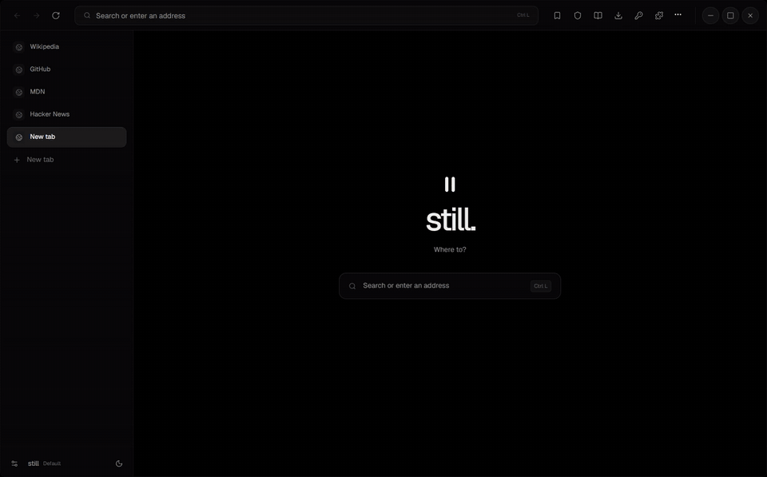

<div align="center">

# still.

**The open-source agent browser that runs on the AI you already pay for.** Claude, ChatGPT or Grok, through their own apps: no API keys, no credits, no extra subscription. Switch AI anytime, even halfway through a task. Your other AI apps can drive it too, through MCP or the command line, once you say yes. Everything stays on your computer.

[**⬇ Download for Windows**](https://github.com/carbongotfound/still/releases/latest/download/Still-Setup-x64.exe) · [**⬇ Download for Mac**](https://github.com/carbongotfound/still/releases/latest/download/Still-mac.dmg) · [**What it does**](#what-you-can-hand-off) · [**Connect your AI**](#connect-your-ai) · [**Install**](#install) · [**Build from source**](#build-from-source)

[](https://github.com/carbongotfound/still/releases/latest)
[](https://github.com/carbongotfound/still/releases)
[](./LICENSE)


</div>

<p align="center"></p>

> **Free and open source.** MIT licensed, built on Microsoft Edge WebView2 and .NET 10 on Windows and on WebKit and Swift on Mac. Your bookmarks, history, passwords and sessions stay on your computer.

> **Not code-signed yet.** On Windows, SmartScreen may warn on first launch: choose **More info → Run anyway**. On Mac, right-click Still and choose **Open** the first time. Or [build it yourself](#build-from-source).

## Why Still?

Your AI can plan a trip, compare products and draft an application, but then you're the one copying links out of a chat and clicking through twenty tabs. Still gives it a real browser to do that part: it opens its own tabs, reads pages, clicks, types, picks dates, answers pop-ups and uploads files, and tells you what it found.

You stay in charge. Each AI app asks before it starts, a bar shows what it's doing with a **Stop** button, and private tabs, saved passwords and cookies are never shown to it. If you've stepped away, it can ask you in its own chat instead of waiting at the browser.

And it's a good browser without the AI: fast, with ads and trackers blocked (YouTube ads too), your old browser imported in one click, and nothing on screen but the page.

## What you can hand off

- *"Find three flights to Tokyo under $900 next week and leave them open for me."*
- *"Compare these four laptops on battery life and price."*
- *"Fill in this job application from my CV."*
- *"Read my open tabs and tell me what each one says."*
- *"Check the order status on these three shops."*

Type it into the address bar and choose **Ask AI**, press <kbd>Ctrl Shift A</kbd>, or ask from Claude Code, Claude Desktop, Cursor or another MCP app.

## Features

**For your AI**

- **Works with the AI you have.** Chat in Still with the Claude, ChatGPT or Grok app on your PC, signed in to your own account. Or connect any MCP app.
- **Its own tabs.** Agents work in background tabs grouped under *AI*, so your tab never changes under you. Several agents can work at once.
- **Handles real sites.** Shadow DOM, iframes, dropdowns, date fields, rich text editors, file uploads, pop-up windows and alert, confirm and prompt dialogs.
- **Cheap on tokens.** Pages come back as short numbered lines, not screenshots. `find` searches a whole page for a fraction of the cost, and ids stay valid between reads.
- **Asks when you're away.** If you aren't at the computer, the agent asks you in its chat, then Still checks your answer with a one-time code.

**For you**

- **One-click import from Chrome, Edge, Brave, Opera GX and Vivaldi** (Windows). Bookmarks, history, saved passwords and **signed-in sessions** come across, so you stay logged in.
- **Built-in blocking.** Ads and trackers are blocked. On YouTube, ads are stripped before the page sees them, and anything that slips through is muted and skipped.
- **Chrome Web Store extensions (Windows).** Open an extension in the store and press **Add to Still**. You review its permissions first.
- **Password vault (Windows).** Encrypted with Windows DPAPI and filled in only on the exact site it belongs to. Nothing is synced anywhere.
- **Memory saver.** Idle background tabs sleep after a minute and wake with their page state; media, calls and downloads stay awake.
- **Keyboard first.** <kbd>Ctrl L</kbd> address bar, <kbd>Ctrl K</kbd> find any tab, <kbd>Ctrl Shift T</kbd> reopen a closed tab, <kbd>F11</kbd> real full screen.
- **And the rest.** Profiles, private tabs, bookmarks bar and Speed Dial, reader mode, "hide an element", picture-in-picture, find in page, dark, light and system themes, and your default browser if you want it.

## Connect your AI

Turn on *Settings → Let other AI apps use Still* (or do it during setup). Then:

**Claude Code**

```powershell
claude mcp add still -- "C:\Users\<you>\AppData\Local\Programs\Still\Still.exe" --mcp
```

**Claude Desktop, Cursor and other MCP apps**

```json
{ "mcpServers": { "still": { "command": "C:\\Users\\<you>\\AppData\\Local\\Programs\\Still\\Still.exe", "args": ["--mcp"] } } }
```

The welcome screen copies both of these with your real path filled in, and Settings has **Copy config**.

**Terminal agents without MCP** run one command per step:

```powershell
Still.exe --cli open_tab url=example.com
Still.exe --cli read_page                       # title, url, numbered elements, page text
Still.exe --cli find text="Sign in"             # matching elements and lines, from anywhere on the page
Still.exe --cli click id=7
Still.exe --cli type id=13 text="hello" submit=true
Still.exe --cli help                            # every tool
```

`read_page` gives each clickable or typeable element a short numbered line:

```
[7] link "Reserved Domains" → /domains/reserved
[13] textbox "Email" =me@x.com
[14] select "Country" =Canada {Canada|France}
[15] checkbox "Remember me" ☐
```

Tools: `list_tabs`, `open_tab`, `navigate`, `switch_tab`, `close_tab`, `go_back`, `go_forward`, `reload`, `read_page`, `find`, `click`, `type`, `press_key`, `scroll`, `wait_for`, `handle_dialog`, `upload_file`, `screenshot` and `list_profiles`.

## Install

### Windows

1. Download **`Still-Setup-x64.exe`** from the [latest release](https://github.com/carbongotfound/still/releases/latest) and run it. No admin rights are needed.
2. Still installs as a normal Windows app with a Start Menu entry. Installing a newer setup updates it in place and keeps your data, and Still updates itself after that.
3. To make Still your default browser, choose **Settings → Make default**.

Prefer portable? Download the single **`Still.exe`** and run it.

Requires Windows 10/11 x64 and the [Microsoft Edge WebView2 Runtime](https://developer.microsoft.com/microsoft-edge/webview2/). Windows 11 already has it, and setup installs it if it's missing.

### Mac

1. Download **`Still-mac.dmg`** from the [latest release](https://github.com/carbongotfound/still/releases/latest), open it and drag **Still** onto **Applications**. It runs natively on Apple silicon and Intel Macs with macOS 12 or later. (Prefer a zip? `Still-mac.zip` holds the same app.)
2. Still isn't notarized yet, so the first time, right-click Still and choose **Open** (on macOS 15, open it once, then choose **Open Anyway** in System Settings → Privacy & Security).
3. To make Still your default browser, choose **Settings → Make default**.

Still for Mac runs the same interface on Apple's WebKit: your companions and AI chats, split view, background tabs, MCP and the command line with the same tools and approval prompts, plus tabs, groups, private windows, profiles, passwords in your Keychain, importing, history, bookmarks, downloads, themes and the same blocking. Extensions and in-app updates are Windows-only for now; on Mac, Still tells you when a new release is out. Shortcuts use <kbd>⌘</kbd> in place of <kbd>Ctrl</kbd>. More in [mac/README.md](mac/README.md).

## Shortcuts

| Action | Shortcut |
|---|---|
| Address / search / ask AI | <kbd>Ctrl L</kbd> |
| Ask AI | <kbd>Ctrl Shift A</kbd> |
| Find an open tab | <kbd>Ctrl K</kbd> |
| New / close tab | <kbd>Ctrl T</kbd> / <kbd>Ctrl W</kbd> |
| Reopen closed tab | <kbd>Ctrl Shift T</kbd> |
| Private tab | <kbd>Ctrl Shift N</kbd> |
| Bookmark page | <kbd>Ctrl D</kbd> |
| Reader mode | <kbd>Ctrl Shift R</kbd> |
| Full screen | <kbd>F11</kbd> |
| Settings | <kbd>Ctrl ,</kbd> |

## How it's built

- **Engine:** on Windows, Microsoft Edge WebView2 (Chromium) in a native **WPF / .NET 10** window. On Mac, Apple WebKit in a native **AppKit / Swift** window ([`mac/`](mac)), built on GitHub Actions.
- **Interface:** React, [shadcn/ui](https://ui.shadcn.com), Radix, Motion and the Geist font, all packaged locally. No web server and no CDN calls.
- **Privacy:** no Still account and no analytics. The only background request is a check of GitHub for a newer release. Your data stays in `%LOCALAPPDATA%\Still` on Windows and `~/Library/Application Support/Still` on Mac.

## Build from source

Requires the .NET 10 SDK and Node 22.12+.

```powershell
git clone https://github.com/carbongotfound/still
cd still
./build.ps1          # builds the UI, then publishes a single Still.exe to artifacts/Still
```

On a Mac with Xcode 15 or newer, `sh mac/build.sh` builds `mac/build/Still.app`, `Still-<version>.dmg` and `Still-mac.zip` from the same interface.

## Security

See [SECURITY.md](SECURITY.md) and the [security review](docs/SECURITY-REVIEW.md). Still has had an internal code review but no independent third-party audit yet, so please report vulnerabilities privately.

## License

Still is open source under the [MIT license](LICENSE), © 2026 Carbon.

The companions are Still's own: the blobs, their gestures and their props are built in code with three.js (`still-ui/src/companion3d.ts`, `Mascot.tsx` and `look.ts`), and so is the app icon. They're original work made for Still and covered by the same MIT license. So are the two sounds in `still-ui/public/sounds` (the intro and the end-of-setup jingle): `tools/sound` makes both in code from sine waves and noise, with nothing sampled or downloaded.

Everything Still bundles from others keeps its own license, and every one of them allows shipping inside an MIT app: MIT, ISC, Apache-2.0, 0BSD, SIL OFL 1.1, BSD-style or public domain, plus Microsoft's redistributable WebView2 bootstrapper. The full list is in [THIRD-PARTY-NOTICES.txt](THIRD-PARTY-NOTICES.txt) and every license text is in [Licenses](Licenses). Both ship inside the Windows installer and the Mac app. The Claude, ChatGPT and Grok names and logos belong to Anthropic, OpenAI and xAI, and Still isn't affiliated with them.
