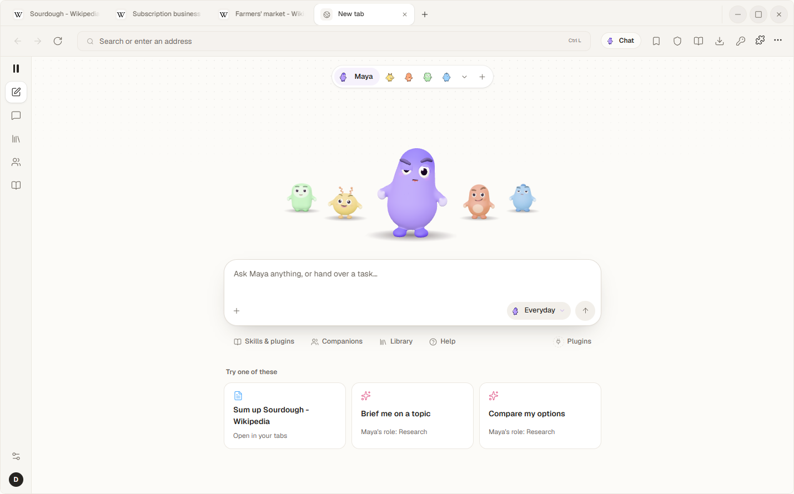
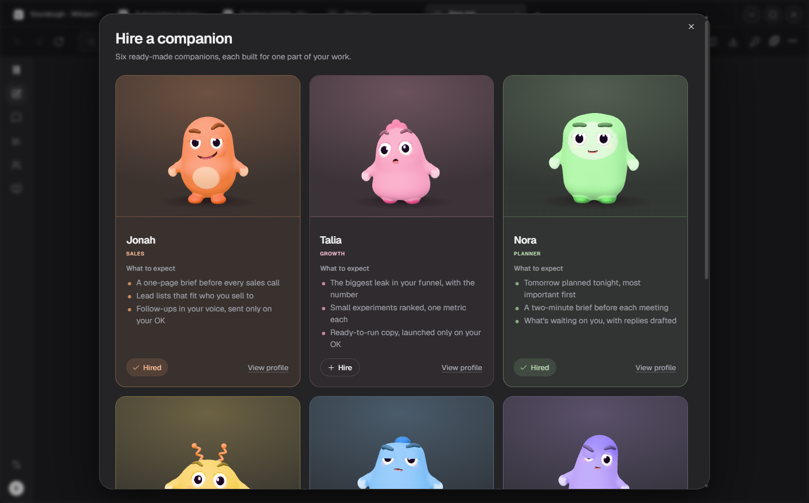
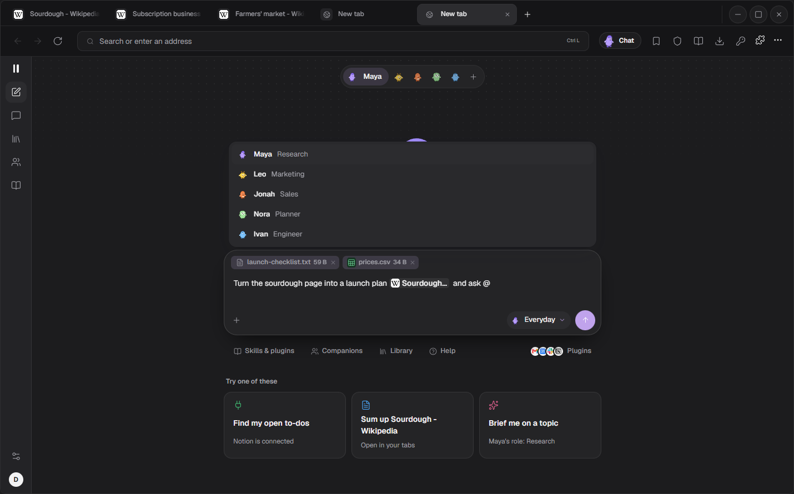
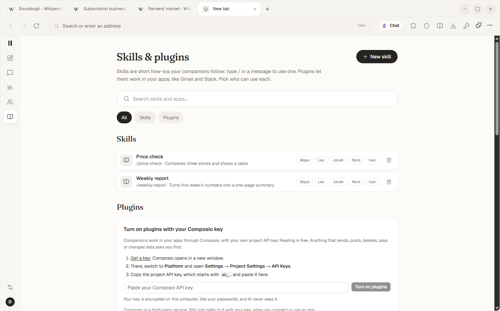
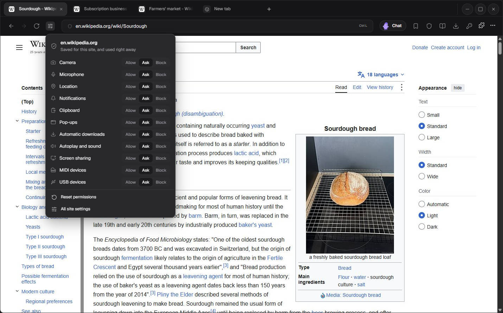
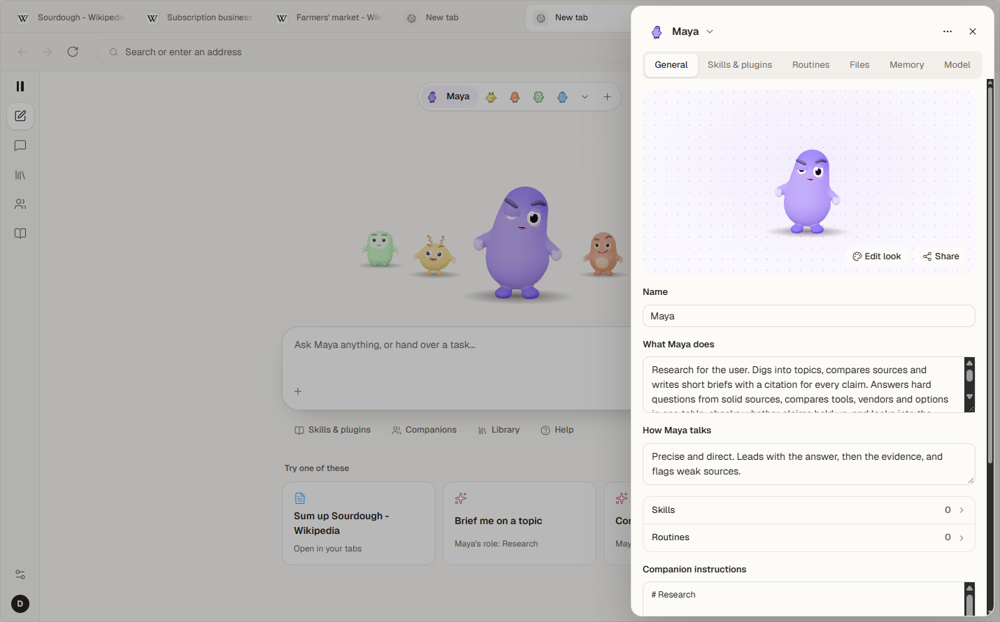
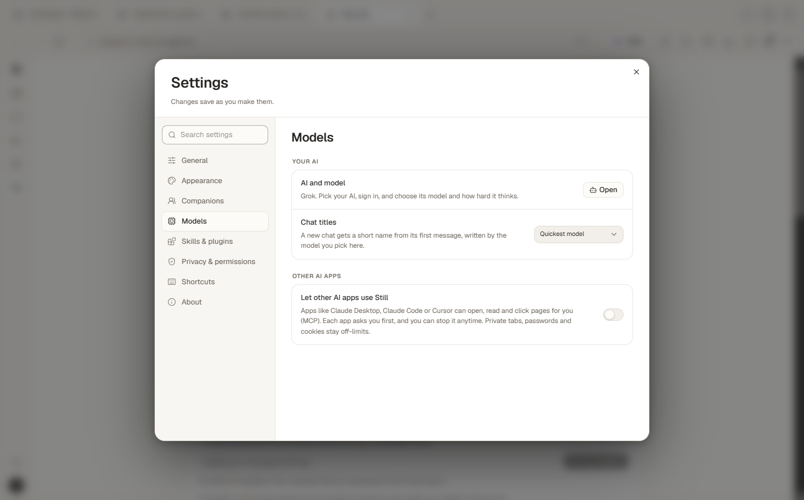

<div align="center">

# still.

**An open-source agent browser that works with the Claude, ChatGPT and Grok CLIs you're already signed into. No API keys.**

[**Download for Windows**](https://github.com/carbongotfound/still/releases/latest/download/Still-Setup-x64.exe) · [**Download for Mac**](https://github.com/carbongotfound/still/releases/latest/download/Still-mac.dmg) · [**Features**](#features) · [**Install**](#install) · [**Connect your AI**](#connect-your-ai) · [**Contributing**](#contributing)

[](https://github.com/carbongotfound/still/releases/latest)
[](./LICENSE)


[](https://github.com/carbongotfound/still/labels/good%20first%20issue)

</div>

<!-- LAUNCH FILM -->
<!-- The 2.0 launch film goes here, between the pitch and the first screenshot: an embed or a linked thumbnail. -->

<p align="center"></p>

Still is a real browser with a team of AI companions built in. Hire the ones you need, give them a task, and they work in their own background tabs: reading pages, clicking, typing, filling forms and reporting back. They run on the Claude, ChatGPT or Grok app you already use, signed in to your own plan, so there's nothing new to pay for and no key to paste. Everything stays on your computer.

## Features

### Companions you hire

Six companions come ready to hire. Each one owns a part of your work and has its own skills, memory, routines and way of talking.

| | Role | What to expect |
|---|---|---|
| **Jonah** | Sales | A one-page brief before every sales call, lead lists that fit who you sell to, follow-ups in your voice sent only on your OK |
| **Talia** | Growth | The biggest leak in your funnel with the number, small experiments ranked with one metric each, ready-to-run copy launched only on your OK |
| **Nora** | Planner | Tomorrow planned tonight with the most important thing first, a two-minute brief before each meeting, what's waiting on you with replies drafted |
| **Leo** | Marketing | One idea turned into posts for every platform, launch posts and newsletters in your voice, drafts only: nothing posts without you |
| **Ivan** | Engineer | Small tools and pages built and tested in Still, bug reports with steps to reproduce, specs with acceptance checks from messy feedback |
| **Maya** | Research | Deep research with cited sources, options compared side by side, claims fact-checked before you share them |
| **Make your own** | Any job | Pick its look, name, job, way of talking, AI and skills, and give it a prop to hold |

<p align="center"></p>

- **Hiring.** *Hire a companion* opens the library. Each card shows the character, its role and what to expect. **View profile** shows its full instructions before you hire. Hired companions show **Hired**.
- **A first chat in its own words.** A new hire opens its first chat by itself: it greets you, says what it will do first, starts on real work with its tools, and asks at most one question.
- **Profiles you can edit.** Click any companion to open its profile: look, instructions, skills and plugins, routines, files, memory and model. Everything saves as you type.
- **Routines.** "Do this at 9:00 on weekdays." Each of the six comes with a starter routine that stays off until you turn it on.
- **Companions work together.** A companion can ask a teammate for help and wait for the answer, or hand work over. You see who asked whom and the reply.
- **Share a companion.** Share copies its look, name and instructions (never its memory or files), and anyone can paste it into their library.

### The message box

<p align="center"></p>

- **`#` attaches a tab.** Type `#` to list your open tabs, pick one, and the companion reads that page. Private tabs never appear and can't be attached.
- **`@` pulls in a companion.** Type `@` to bring a teammate into the task. The companion you're talking to asks them and works with the answer.
- **Drag and drop files.** Drop files on the message box, paste an image, or choose **+ > Add files**. Up to 10 files a message (10 MB each, images up to 5 MB). Text, code, PDFs and images all work, with every AI.
- **`/` runs a skill.** Type `/` to pick one of your skills.
- **Automatic chat titles.** A new chat names itself from its first message, using your AI's quickest model. Pick another model or turn it off in **Settings > Models**.

### Skills & plugins

<p align="center"></p>

- **Skills** are Markdown files with a short header: a name, what it does, and when to use it. Give a skill to any companion with one click, or run it with `/`.
- **Plugins** connect your apps (Gmail, Slack, Notion, GitHub and many more) through [Composio](https://composio.dev) with **your own** project API key. Plugins stay off until you paste a key. Still keeps it in Windows DPAPI or the macOS Keychain, never in a file an AI can read.
- **Reads are free, writes ask first.** Anything that sends, posts, deletes, pays or changes data waits for your OK.
- The **Plugins** button under the new tab's message box shows the apps you've connected and opens Skills & plugins.

### Memory

- Each companion has its own memory, kept on your computer as plain JSON and used only in that companion's chats.
- See, add, edit and forget what each one remembers in **Settings > Companions > What they remember**.
- Passwords, codes, keys, card and account numbers, form text the AI typed and anything from a private tab are never stored.
- Set a chat to **no memory** and nothing from it is kept.

### You stay in charge

<p align="center"></p>

- **Per-site permissions.** The Permissions button sets Allow, Ask or Block for each site: camera, microphone, location, notifications, clipboard, pop-ups, automatic downloads, sound, screen sharing, MIDI and USB.
- **AI permissions.** Every action an AI takes is a read, a navigation, an interaction or a sensitive step. Set rules per site and per companion: always, once per chat, or every time.
- **Sensitive steps wait.** Buying, sending, deleting, posting forms and payment fields always show an 8 second countdown you can cancel, even when allowed.
- **Watch, take over or stop.** A colored cursor shows where the companion clicks. **Take over** pauses it while you drive, and **Stop** ends the run.
- **Asks when you're away.** If you've stepped away, the companion asks in its chat instead of waiting at the browser.

### A full browser

- Tabs, groups, split view, multiple windows, private windows and profiles, with Classic (tabs on top) or Modern (tabs on the side) layouts.
- Ads and trackers blocked, YouTube ads included.
- One-click import from Chrome, Edge, Brave, Opera GX, Vivaldi and Firefox, signed-in sessions included (Windows). Safari bookmarks and history on the Mac.
- A password manager encrypted with Windows DPAPI or the macOS Keychain, filled only on the exact site it belongs to.
- Chrome Web Store extensions (Windows), reader mode, picture-in-picture, a memory saver for idle tabs, and light and dark themes.

### Use Still from other AI apps

Turn on **Settings > Models > Let other AI apps use Still** and Claude Code, Claude Desktop, Cursor or any MCP app can drive it. Each app asks once before it starts.

```powershell
claude mcp add still -- "C:\Users\<you>\AppData\Local\Programs\Still\Still.exe" --mcp
```

```json
{ "mcpServers": { "still": { "command": "C:\\Users\\<you>\\AppData\\Local\\Programs\\Still\\Still.exe", "args": ["--mcp"] } } }
```

Settings has **Copy config** with your real path filled in. Agents without MCP can run one step at a time: `Still.exe --cli open_tab url=example.com`, `Still.exe --cli read_page`, `Still.exe --cli help`.

<table>
<tr>
<td width="50%"></td>
<td width="50%"></td>
</tr>
<tr>
<td align="center">A companion's profile</td>
<td align="center">Settings</td>
</tr>
</table>

## Install

### Windows

1. Download [**Still-Setup-x64.exe**](https://github.com/carbongotfound/still/releases/latest/download/Still-Setup-x64.exe) and run it. No admin rights needed.
2. Still isn't code-signed yet, so SmartScreen may warn the first time. Choose **More info > Run anyway**.
3. Setup walks you through importing your old browser, picking your AI and hiring your first companions.

Still updates itself after that. Prefer a portable copy? Download `Still.exe` from the [latest release](https://github.com/carbongotfound/still/releases/latest).

### macOS

1. Download [**Still-mac.dmg**](https://github.com/carbongotfound/still/releases/latest/download/Still-mac.dmg), open it and drag **Still** to **Applications**. It runs natively on Apple silicon and Intel.
2. Still isn't notarized yet, so the first time, right-click Still and choose **Open**. On macOS 15, open it once, then choose **Open Anyway** in **System Settings > Privacy & Security**.

### Requirements

- **Windows** 10 (1809 or later) or 11, x64. Setup installs the Microsoft Edge WebView2 Runtime if it's missing.
- **macOS** 12 or later.
- **An AI app** for the companions: Claude Code, ChatGPT's CLI from OpenAI, or Grok Build, signed in to your own account. Setup can install and sign in for you. Still works as a browser without one.

## Connect your AI

Still runs the AI's own command-line app in the background, signed in to your plan. It never asks for an API key, never reads the app's login, and removes API-key settings from each run so nothing is billed to an API account.

| AI | What Still runs | How it connects |
|---|---|---|
| **Claude** | [Claude Code](https://claude.com/product/claude-code) | **Install it for me** runs Anthropic's official installer. **Sign in with Anthropic** opens Claude's own sign-in. |
| **ChatGPT** | OpenAI's agent CLI | **Install it for me** installs it from npm. **Sign in with OpenAI** uses your ChatGPT account. API-key logins are ignored. |
| **Grok** | [Grok Build](https://x.ai/cli) | **Install it for me** runs xAI's official installer. **Sign in with xAI** opens xAI's device sign-in. |

The buttons are on each AI's tile in setup and in the chat's AI picker. If the app is already installed and signed in, Still finds it. Switch AI anytime, even halfway through a chat: the chat moves over with its history.

## Privacy

- **No telemetry.** No Still account, no analytics. The only request Still makes on its own is a check of GitHub for a newer release.
- **Agents never see private tabs, saved passwords or cookies.** Fields that hold saved logins read as hidden. When a companion reaches a sign-in page it pauses and asks you to sign in, then carries on.
- **Private tabs never save passwords, history or form data.**
- **Your data stays local** in `%LOCALAPPDATA%\Still` on Windows and `~/Library/Application Support/Still` on the Mac.
- **Plugins are opt-in.** They talk to Composio only after you paste your own key, and only for the apps you connect.

## Build from source

**Windows** needs the [.NET 10 SDK](https://dotnet.microsoft.com/download/dotnet/10.0) (10.0.401 or a later patch) and Node 22.12 or newer.

```powershell
git clone https://github.com/carbongotfound/still
cd still
./build.ps1              # UI tests, lint and build, then a self-contained Still.exe in artifacts/Still
./build.ps1 -Installer   # also builds the installer (needs Inno Setup 7's ISCC.exe on your PATH)
```

**macOS** needs Xcode 15 or newer. `sh mac/build.sh` builds `mac/build/Still.app`, a `.dmg` and `Still-mac.zip` from the same interface.

More detail, including how to run the tests, is in [CONTRIBUTING.md](CONTRIBUTING.md).

## Contributing

First-time contributors are welcome. Pick one of the [good first issues](https://github.com/carbongotfound/still/labels/good%20first%20issue), or [open an issue](https://github.com/carbongotfound/still/issues/new/choose) with a bug or an idea. [CONTRIBUTING.md](CONTRIBUTING.md) covers setting up, running the tests, how the code is laid out, and adding a companion, skill or plugin. Everyone taking part follows the [Code of Conduct](CODE_OF_CONDUCT.md).

[FEATURES.md](FEATURES.md) maps every feature to the code that runs it.

## Security

See [SECURITY.md](SECURITY.md) and the [security review](docs/SECURITY-REVIEW.md). Still has had internal code reviews but no independent audit yet, so please report vulnerabilities privately rather than in a public issue.

## License

Still is open source under the [MIT license](LICENSE), © 2026 Carbon.

The companions, their animations and props, the app icon and the two setup sounds are original work made for Still and covered by the same license. Everything Still bundles from others keeps its own license: the list is in [THIRD-PARTY-NOTICES.txt](THIRD-PARTY-NOTICES.txt) and every license text is in [Licenses](Licenses). Claude, ChatGPT and Grok and their logos belong to Anthropic, OpenAI and xAI. Still isn't affiliated with them.
